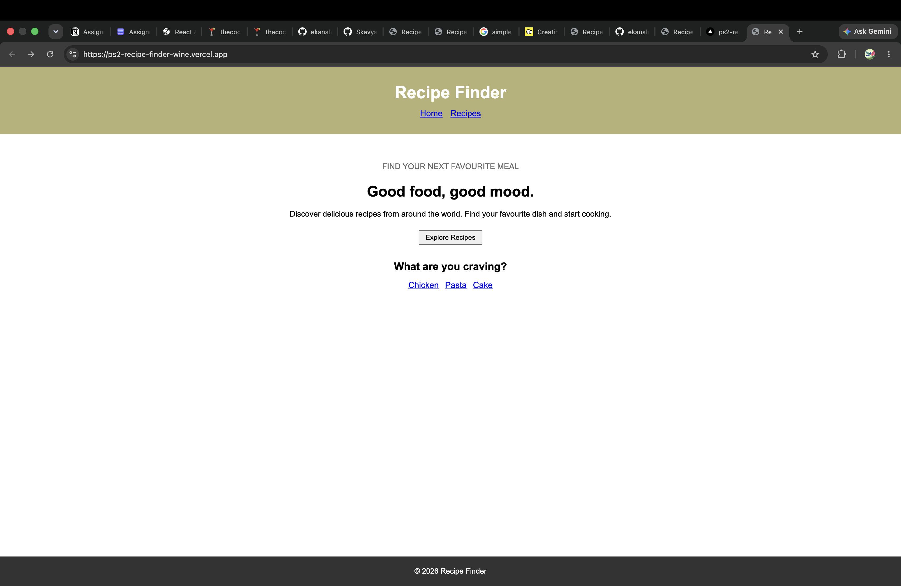
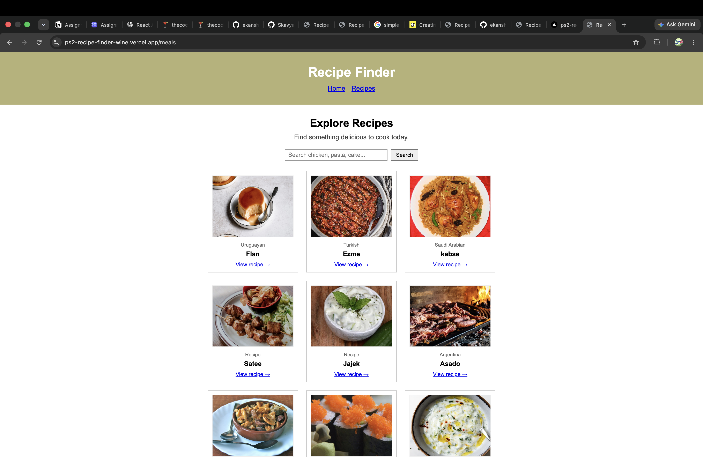

# 🍲 PS2: Recipe Finder

## 📌 Problem Statement
**PS2 – Recipe Finder**

## 📝 About the Project
Recipe Finder is a web application that allows users to search for recipes by dish name and explore complete recipe details. Users can discover meals, view ingredients and their measurements, read cooking instructions, and access related YouTube cooking videos.

The application uses **TheMealDB API** to fetch recipe data dynamically.

## ✨ Features
- **Home Page:** Hero section with quick-search buttons for Chicken, Pasta, and Cake.
- **Search Recipes:** Search for dishes and view matching recipes.
- **Recipe Cards:** Display recipe images, names, categories, and cuisine.
- **Recipe Details:** View full recipe information, including ingredients, measurements, and cooking instructions.
- **YouTube Link:** Access a related cooking video when available.
- **No Results Message:** Displays "No recipe found" when no matching recipes are returned.
- **404 Page:** Displays a Page Not Found message with a link to the home page.
- **Categories (Bonus):** Browse meal categories and filter recipes by category.

## 🛠️ Technologies Used
- HTML
- CSS
- JavaScript
- TheMealDB API
- [Add your framework or library here, if applicable]

## 🔗 API Used
**TheMealDB API**

1. **Search meals by name**
   - https://www.themealdb.com/api/json/v1/1/search.php?s=chicken

2. **Lookup meal details by ID**
   - https://www.themealdb.com/api/json/v1/1/lookup.php?i=52772

3. **Fetch meal categories**
   - https://www.themealdb.com/api/json/v1/1/categories.php

4. **Filter meals by category**
   - https://www.themealdb.com/api/json/v1/1/filter.php?c=Seafood

## 🛣️ Application Routes

| Route | Description |
|---|---|
| `/` | Home page with hero section and quick-search buttons |
| `/meals` | Displays searchable meal cards with images, names, categories, and cuisine |
| `/meal/:id` | Displays full recipe details, ingredients, measurements, instructions, and YouTube link |
| `/categories` | Displays available meal categories (Bonus) |
| `/categories/:name` | Displays meals filtered by category (Bonus) |
| `*` | Displays a Page Not Found message with a link to Home |

## 📸 Screenshots

### 1. Home Page


### 2. Recipe Details Page



## 🚀 Live Demo
**Live Website:** ps2-recipe-finder.vercel.app

## 💻 Run Locally

1. Clone the repository:

   ```bash
   git clone YOUR_GITHUB_REPOSITORY_URL
   ```

2. Navigate to the project directory:

   ```bash
   cd YOUR_PROJECT_FOLDER
   ```

3. Install dependencies, if applicable:

   ```bash
   npm install
   ```

4. Start the development server using the command configured in your `package.json`, for example:

   ```bash
   npm run dev
   ```

5. Open the local URL displayed in your terminal.


## 📂 Project Structure

```text
recipe-finder/
├── public/
├── src/
│   ├── components/
│   ├── pages/
│   ├── App.jsx
│   └── main.jsx
├── screenshots/
│   ├── home.png
│   └── recipe-details.png
├── package.json
└── README.md
```

## 👨‍💻 Author
**Kavya**

- GitHub: https://github.com/Skavya-06/ps2-recipe_finder
- Live Demo: ps2-recipe-finder.vercel.app

## 📄 License
This project was created for educational purposes as part of the PS2 Recipe Finder assignment.
# ps2-recipe_finder
